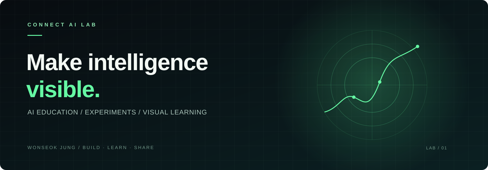

<b>AI를 이해하는 가장 좋은 방법은, 직접 보고 만들어보는 것.</b> From complex ideas to visual, hands-on experiences.

<a href="https://www.youtube.com/@CONNECT-AI-LAB"><b>YOUTUBE ↗</b></a> &nbsp;&nbsp; / &nbsp;&nbsp; <a href="https://www.aicitybuilders.com/program"><b>AI CITY BUILDERS ↗</b></a> &nbsp;&nbsp; / &nbsp;&nbsp; <a href="https://www.aicitybuilders.com/ppo"><b>EXPLORE PPO ↗</b></a>

 

### 01 &nbsp; / &nbsp; THE LAB

안녕하세요, **Wonseok Jung**입니다. Connect AI Lab에서 강화학습과 AI를 더 많은 사람이 이해하고 직접 활용할 수 있도록 강의, 실험, 시각화 콘텐츠를 만듭니다.

I build learning experiences that connect **AI concepts, code, and visual storytelling** — turning abstract ideas into something you can explore.

<table><tr><td width="33%"><b>LEARN</b> 복잡한 AI를 이해하기 쉽게</td><td width="33%"><b>BUILD</b> 코드와 실험으로 직접 만들기</td><td width="33%"><b>VISUALIZE</b> 눈으로 보고 감각적으로 이해하기</td></tr></table>

### 02 &nbsp; / &nbsp; SELECTED WORK

<table>
<tr><td width="50%"><b>01 &nbsp; Reinforcement Learning</b>  강화학습의 핵심 개념과 실습을 함께 탐구하는 자료.  <a href="https://github.com/wonseokjung/ReinforcementLearning_byWonseok">Explore the repository ↗</a></td><td width="50%"><b>02 &nbsp; AI Super Mario</b>  강화학습으로 슈퍼마리오를 플레이하는 튜토리얼.  <a href="https://github.com/wonseokjung/ai_supermario">Explore the repository ↗</a></td></tr>
<tr><td><b>03 &nbsp; Deep Reinforcement Learning</b>  CS294 기반의 딥 강화학습 학습 자료.  <a href="https://github.com/wonseokjung/RLXDL">Explore the repository ↗</a></td><td><b>04 &nbsp; PPO, made visual</b>  PPO의 개념을 인터랙티브한 시각 자료로 살펴보기.  <a href="https://www.aicitybuilders.com/ppo">Explore the experience ↗</a></td></tr>
</table>

### 03 &nbsp; / &nbsp; CONNECT

**Learn with us** → [CONNECT AI LAB on YouTube](https://www.youtube.com/@CONNECT-AI-LAB)  
**Explore the curriculum** → [AI CITY BUILDERS](https://www.aicitybuilders.com/program)

 

CONNECT AI LAB &nbsp; · &nbsp; BUILD / LEARN / SHARE

