<picture>
  <source media="(prefers-color-scheme: dark)" srcset="./assets/svg/boot_dark.svg" />
   booting CONNECT AI LAB ... > loading AI MENTOR JAY > CEO of AI native companies > The most beautiful way to learn AI business" />
</picture>

<a href="https://www.youtube.com/@CONNECT-AI-LAB">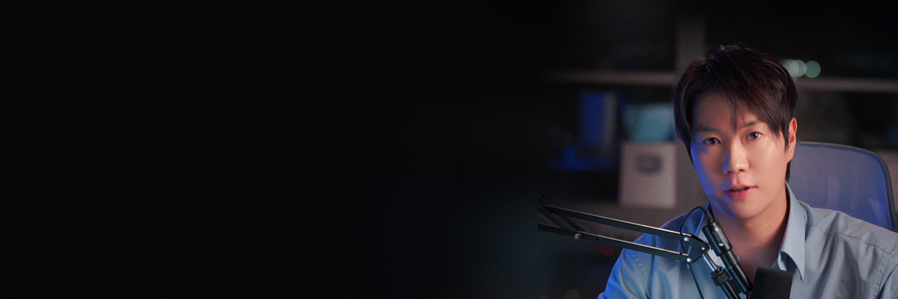</a>

 

<picture>
  <source media="(prefers-color-scheme: dark)" srcset="./assets/svg/identity_dark.svg" />
  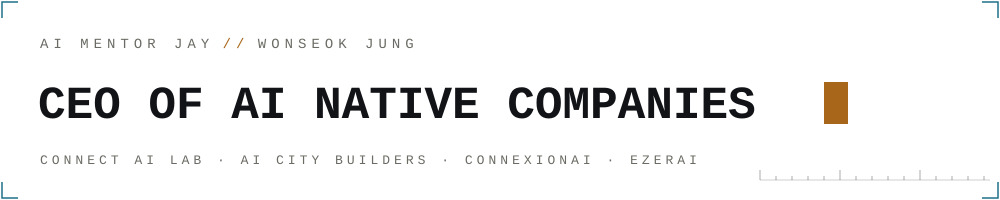
</picture>

  <b>AI 비즈니스를 배우는 가장 멋진 방법</b> 
  모두를 위한 AI 교육 &nbsp;·&nbsp; The most beautiful way to learn AI business. AI education for everyone.

  I'm Jay, your AI mentor. Learn AI, build real projects, and put your skills to work.

  
  
  

 

<picture>
  <source media="(prefers-color-scheme: dark)" srcset="./assets/svg/sec01_dark.svg" />
  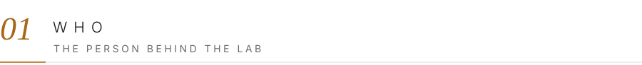
</picture>

 

<h3 align="center">연구원처럼 연구하고, 경영자처럼 운영하고, 개발자처럼 만들고, 운동선수처럼 끝까지 갑니다.</h3>

<i>Research like a scientist. Run like a CEO. Build like an engineer. Never quit, like an athlete.</i>

 

<picture>
  <source media="(prefers-color-scheme: dark)" srcset="./assets/svg/timeline_dark.svg" />
  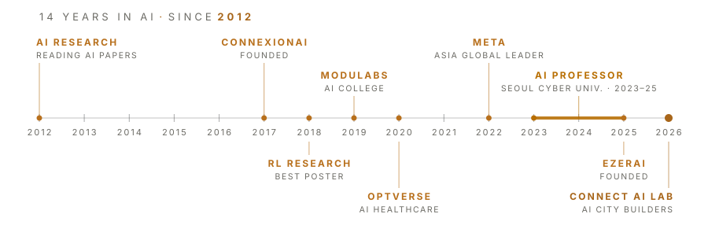
</picture>

<table>
<tr><td width="22%" valign="top"><b>CEO</b></td><td><b>CEO of AI native companies</b> CONNECT AI LAB · AI CITY BUILDERS · 커넥젼에이아이 대표 · 에제르에이아이 대표 2017 ConnexionAI 설립 · 2020 AI 헬스케어 스타트업 옵트버스 설립 · 2025 에제르에이아이 (EZERAI) 설립</td></tr>
<tr><td valign="top"><b>PROFESSOR</b></td><td><b>서울사이버대학교 인공지능 교수</b> (2023–2025) 강의 실습: <a href="https://github.com/wonseokjung/rl-all">강화학습 · 현대 인공지능</a></td></tr>
<tr><td valign="top"><b>RESEARCH</b></td><td>2018 PostAI 강화학습 연구 · Best Poster Award 수상 2019 모두의연구소 인공지능 선임연구원 · AI COLLEGE 기획 및 운영 2022 메타 아시아 지역 글로벌 리더 선정</td></tr>
<tr><td valign="top"><b>OPEN LECTURES</b></td><td>2017–2018 · <a href="https://github.com/wonseokjung/ReinforcementLearning_byWonseok">강화학습의 거의 모든 것</a> · <a href="https://github.com/wonseokjung/ai_supermario">강화학습으로 슈퍼마리오 만들기</a> · <a href="https://github.com/wonseokjung/KIPS_Reinforcement">한국정보처리학회 강화학습 강의</a> · <a href="https://github.com/wonseokjung/moduyeon_supermario">모두의연구소 풀잎스쿨 슈퍼마리오 대회</a> · 2018 1st 딥러닝컨퍼런스 RunningA.I 발표</td></tr>
<tr><td valign="top"><b>EDUCATION</b></td><td>Illinois Institute of Technology (일리노이 공과대학교) · 데이터과학 석사 City University of New York, Baruch College (뉴욕시립대 바루크 컬리지) · 데이터과학 학사</td></tr>
</table>

 

<picture>
  <source media="(prefers-color-scheme: dark)" srcset="./assets/svg/sec02_dark.svg" />
  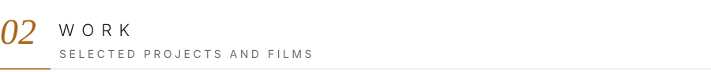
</picture>

<table>
<tr>
<td width="50%" valign="top">
<a href="https://www.youtube.com/watch?v=KjqOOqwyqqc">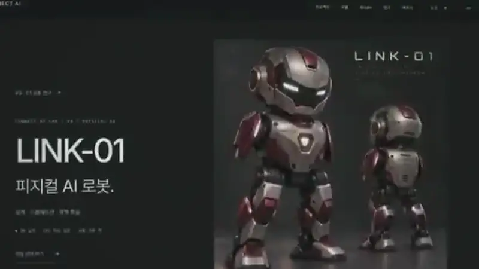</a> 
<b>LINK-01</b> &nbsp;PHYSICAL AI 
로봇도, 두뇌도, 시뮬레이터도 <a href="https://www.youtube.com/watch?v=KjqOOqwyqqc">Watch</a> · <a href="https://www.aicitybuilders.com/robot">강화학습 AI</a>
</td>
<td width="50%" valign="top">
<a href="https://www.youtube.com/watch?v=KjqOOqwyqqc">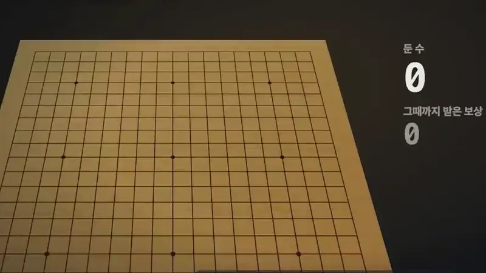</a> 
<b>REINFORCEMENT LEARNING</b> &nbsp;SINCE 2017 
바둑: 보상은 수백 수 뒤에 <a href="https://www.youtube.com/watch?v=KjqOOqwyqqc">강화학습 인문학 2편</a> · <a href="https://www.aicitybuilders.com/ppo">PPO page</a>
</td>
</tr>
<tr>
<td width="50%" valign="top">
<a href="https://www.youtube.com/watch?v=KjqOOqwyqqc">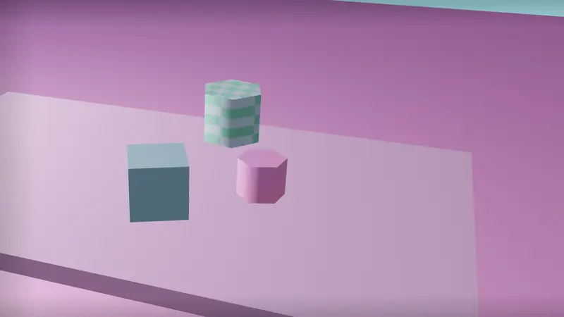</a> 
<b>RESEARCH</b> &nbsp;ICAART 2027 
구독자와 함께 쓴 논문 · ICAART 2027 제출 완료 <a href="https://www.youtube.com/watch?v=KjqOOqwyqqc">Watch</a>
</td>
<td width="50%" valign="top">
<a href="https://www.youtube.com/watch?v=vopSo8YHUrc">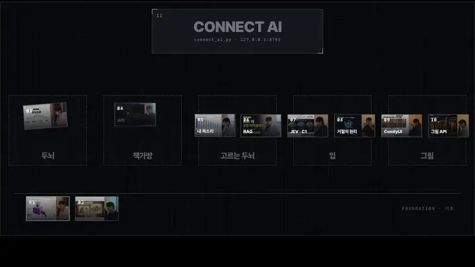</a> 
<b>LOCAL AI</b> &nbsp;나만의 인공지능 
다마고치처럼 나만의 AI 두뇌 키우기 <a href="https://www.youtube.com/watch?v=vopSo8YHUrc">Watch</a> · <a href="https://github.com/wonseokjung/tamagotchi-ai">tamagotchi-ai</a> · <a href="https://www.aicitybuilders.com/localai">Course</a>
</td>
</tr>
<tr>
<td width="50%" valign="top">
<a href="https://www.youtube.com/watch?v=d-WRGKllOKU">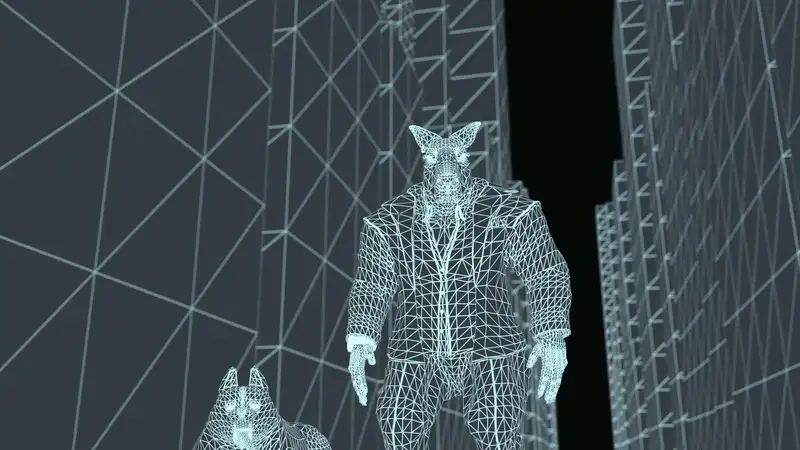</a> 
<b>AI × 3D</b> &nbsp;BLENDER MCP 
바이브코딩으로 AI 3D 영상 만들기 <a href="https://www.youtube.com/watch?v=d-WRGKllOKU">Watch</a>
</td>
<td width="50%" valign="top">
<a href="https://www.youtube.com/watch?v=d-WRGKllOKU">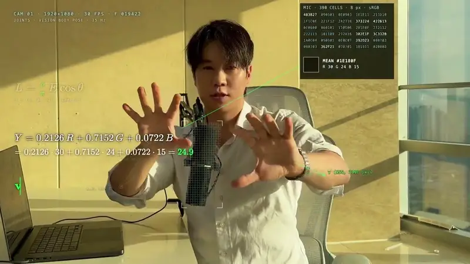</a> 
<b>AR</b> &nbsp;LIVE IN BOTH WORLDS 
오픈소스 블렌더 MCP 원리와 활용 <a href="https://www.youtube.com/watch?v=d-WRGKllOKU">Watch</a>
</td>
</tr>
<tr>
<td width="50%" valign="top">
<a href="https://www.youtube.com/watch?v=pnQUKnmPkFg">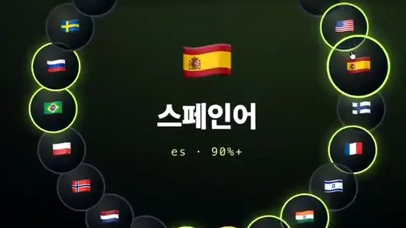</a> 
<b>AI DUBBING</b> &nbsp;IN YOUR OWN VOICE 
로컬 AI로 다국어 더빙하는 법 <a href="https://www.youtube.com/watch?v=pnQUKnmPkFg">Watch</a>
</td>
<td width="50%" valign="top">
<a href="https://www.youtube.com/watch?v=7NBu5IW_2Xw">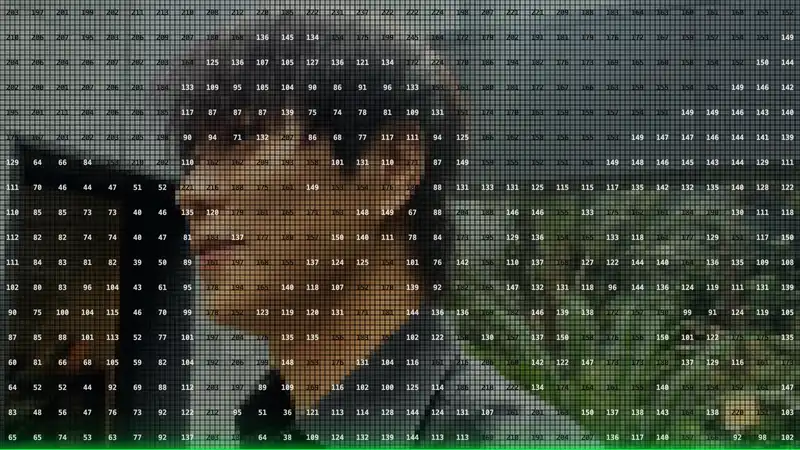</a> 
<b>MOTION × CODE</b> &nbsp;REMOTION 
영상 바이브코딩의 시대 <a href="https://www.youtube.com/watch?v=7NBu5IW_2Xw">예제 44개, 코드까지</a>
</td>
</tr>
</table>

 

<picture>
  <source media="(prefers-color-scheme: dark)" srcset="./assets/svg/city_dark.svg" />
  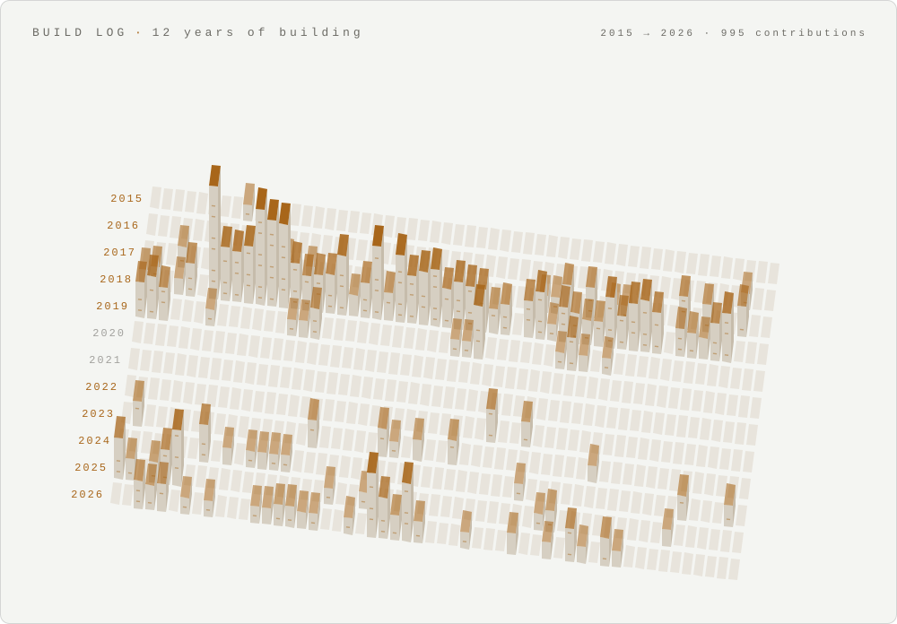
</picture>

 

<picture>
  <source media="(prefers-color-scheme: dark)" srcset="./assets/svg/sec03_dark.svg" />
  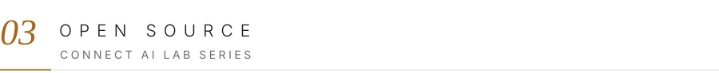
</picture>

<table>
<tr>
<td width="50%" valign="top">
<a href="https://github.com/wonseokjung/reversebusiness">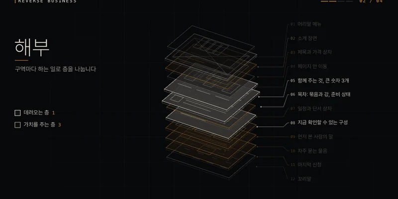</a> 
<a href="https://github.com/wonseokjung/reversebusiness"><b>reversebusiness</b></a> &nbsp; 
Give it one business URL. Read how the business works, then build your own version.
</td>
<td width="50%" valign="top">
<a href="https://github.com/wonseokjung/connect-ai-video-motion">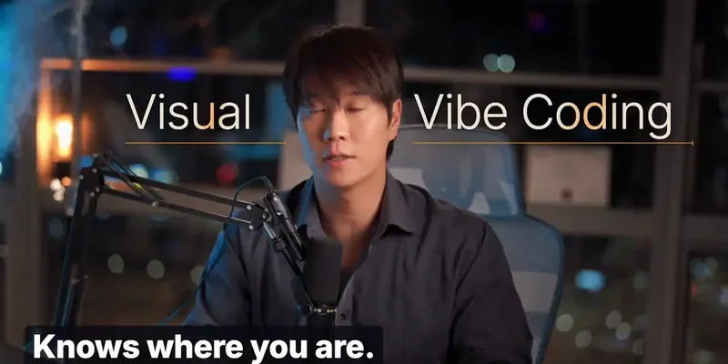</a> 
<a href="https://github.com/wonseokjung/connect-ai-video-motion"><b>connect-ai-video-motion</b></a> &nbsp; 
Motion graphics on top of your own video, never on your face. Runs on Remotion.
</td>
</tr>
<tr>
<td width="50%" valign="top">
<a href="https://github.com/wonseokjung/connect-ai-marketer">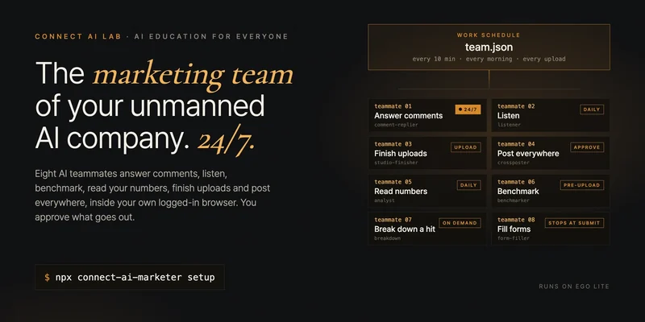</a> 
<a href="https://github.com/wonseokjung/connect-ai-marketer"><b>connect-ai-marketer</b></a> &nbsp; 
The marketing team of your unmanned AI company. 8 AI teammates in your own logged-in browser.
</td>
<td width="50%" valign="top">
<a href="https://github.com/wonseokjung/blender-mcp-vibecoding">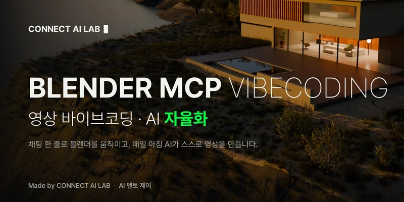</a> 
<a href="https://github.com/wonseokjung/blender-mcp-vibecoding"><b>blender-mcp-vibecoding</b></a> &nbsp; 
Blender MCP tutorials and practice models for video vibe coding.
</td>
</tr>
</table>

<table>
<tr><td width="34%"><a href="https://github.com/wonseokjung/connect-ai"><b>connect-ai</b></a> </td><td>100% 로컬 AI 코딩 에이전트. Antigravity, VS Code, Cursor에서 오프라인으로 동작합니다. Ollama 기반.</td></tr>
<tr><td><a href="https://github.com/wonseokjung/connect-tycoon"><b>connect-tycoon</b></a></td><td>시뮬레이터로 기업 의사결정 모델을 학습시키는 오픈소스 강화학습 게임 · JEV · PPO · Human-in-the-loop</td></tr>
<tr><td></td><td>AI CITY BUILDERS 실습 코랩 노트북. 코랩에서 바로 열립니다.</td></tr>
<tr><td><a href="https://huggingface.co/models?search=connectailab"><b>connectailab models</b></a></td><td>허깅페이스에 공개된 connectailab 강화학습 모델</td></tr>
</table>

 

<picture>
  <source media="(prefers-color-scheme: dark)" srcset="./assets/svg/sec04_dark.svg" />
  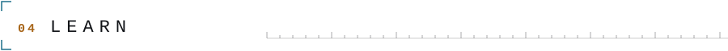
</picture>

<b>AI 1인 기업가를 양성하고, 투자합니다.</b> &nbsp;<a href="https://www.aicitybuilders.com/ceo">AI CITY BUILDERS</a> 
AI education for everyone. In every language. &nbsp;<a href="https://www.aicitybuilders.com/en">aicitybuilders.com/en</a>

<table>
<tr><td width="34%"><a href="https://www.aicitybuilders.com/content-creation"><b>AI 콘텐츠 자동화</b></a></td><td>분석부터 발행까지, 내 손으로</td></tr>
<tr><td><a href="https://www.aicitybuilders.com/localai"><b>나만의 인공지능</b></a></td><td>로컬 AI의 정석</td></tr>
<tr><td><a href="https://www.aicitybuilders.com/robot"><b>강화학습 AI</b></a></td><td>피지컬 AI와 다음 세대 자동화 AI 에이전트의 기반</td></tr>
<tr><td><a href="https://www.aicitybuilders.com/vibecoding"><b>비주얼 바이브코딩</b></a></td><td>보이는 것을 코드로</td></tr>
</table>

Free first steps: <a href="https://www.aicitybuilders.com/ask">find your first lesson</a> · <a href="https://www.aicitybuilders.com/guide">free learning guides</a> &nbsp;&nbsp; Business: <a href="mailto:jay@connexionai.kr">jay@connexionai.kr</a>

 

<picture>
  <source media="(prefers-color-scheme: dark)" srcset="./assets/svg/footer_dark.svg" />
  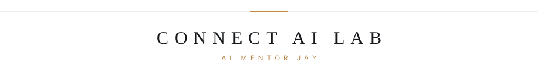
</picture>

AI 비즈니스를 배우는 가장 멋진 방법 &nbsp;·&nbsp; 모두를 위한 AI 교육 &nbsp;·&nbsp; Love Reinforcement Learning

