<a href="https://www.youtube.com/@CONNECT-AI-LAB">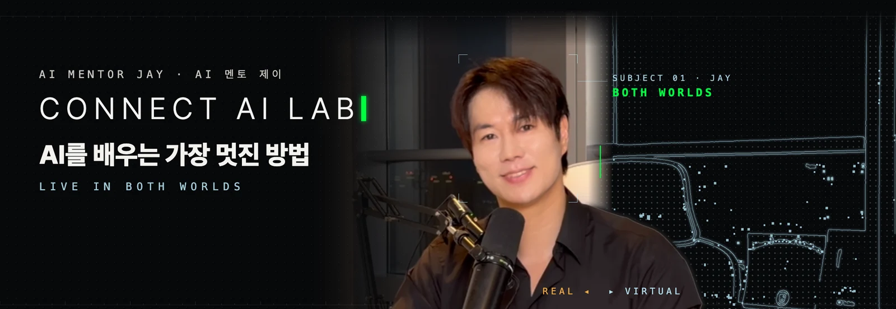</a>

  <b>I'm Jay, your AI mentor. Learn AI, build real projects, and put your skills to work.</b> 
  AI MENTOR JAY · WONSEOK JUNG · CONNECT AI LAB · AI CITY BUILDERS

  
  
  
  

 

<picture>
  <source media="(prefers-color-scheme: dark)" srcset="./assets/svg/sec01_dark.svg" />
  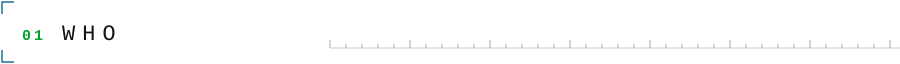
</picture>

<h3 align="center">연구원처럼 연구하고, 경영자처럼 운영하고, 개발자처럼 개발하고, 운동선수처럼 포기하지 않는 사람을 기릅니다.</h3>

Research like a researcher. Run it like an operator. Build like a developer. Never give up, like an athlete.

<picture>
  <source media="(prefers-color-scheme: dark)" srcset="./assets/svg/timeline_dark.svg" />
  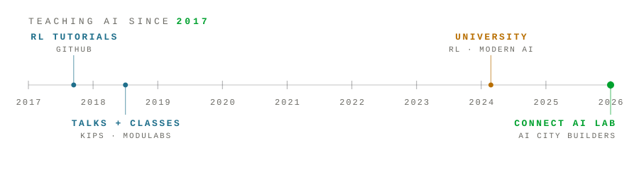
</picture>

<table>
<tr><td width="22%"><b>2017 – 2018</b></td><td><a href="https://github.com/wonseokjung/ReinforcementLearning_byWonseok">강화학습의 거의 모든 것</a> · <a href="https://github.com/wonseokjung/ai_supermario">강화학습을 이용한 슈퍼마리오 만들기 튜토리얼</a> · <a href="https://github.com/wonseokjung/KIPS_Reinforcement">한국정보처리학회 강화학습 강의</a> · <a href="https://github.com/wonseokjung/moduyeon_supermario">모두의연구소 풀잎스쿨 슈퍼마리오 대회</a> · <a href="https://github.com/wonseokjung/2018_DL_conference_RunningAI-">2018 1st 딥러닝컨퍼런스 RunningA.I 발표</a></td></tr>
<tr><td><b>University</b></td><td>Professor · 대학 강의 — <a href="https://github.com/wonseokjung/rl-all">강화학습 · 현대 인공지능</a></td></tr>
<tr><td><b>Company</b></td><td>ConnexionAI CEO · 교육 스타트업에서 인공지능 교육</td></tr>
<tr><td><b>Study</b></td><td>City University of New York — Baruch College, Data Science · Illinois Tech, Master — Data Science</td></tr>
</table>

 

<picture>
  <source media="(prefers-color-scheme: dark)" srcset="./assets/svg/sec02_dark.svg" />
  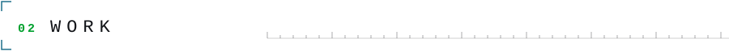
</picture>

<table>
<tr>
<td width="50%" valign="top">
<a href="https://www.youtube.com/watch?v=XZQ3zn_UDZw">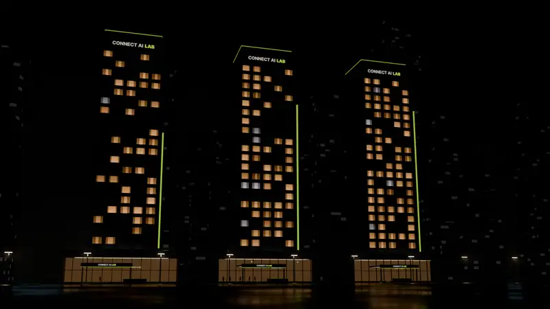</a> 
<b>CONNECT AI WORLD</b> · Decision-making AI 
회사 두뇌 AI · 세상은 시뮬레이터입니다 — <a href="https://www.youtube.com/watch?v=XZQ3zn_UDZw">2주차</a> · <a href="https://www.youtube.com/watch?v=YoXNiQk6k8I">3주차</a> · <a href="https://www.youtube.com/watch?v=Z8h9gkZeZcA">4주차</a>
</td>
<td width="50%" valign="top">
<a href="https://www.aicitybuilders.com/robot">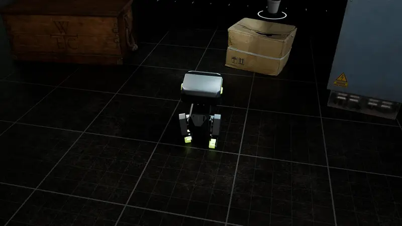</a> 
<b>LINK-01</b> · Robot decision arena 
강화학습 AI — 피지컬 AI와 다음 세대 자동화 AI 에이전트의 기반 — <a href="https://www.aicitybuilders.com/robot">course</a>
</td>
</tr>
<tr>
<td width="50%" valign="top">
<a href="https://www.aicitybuilders.com/ppo">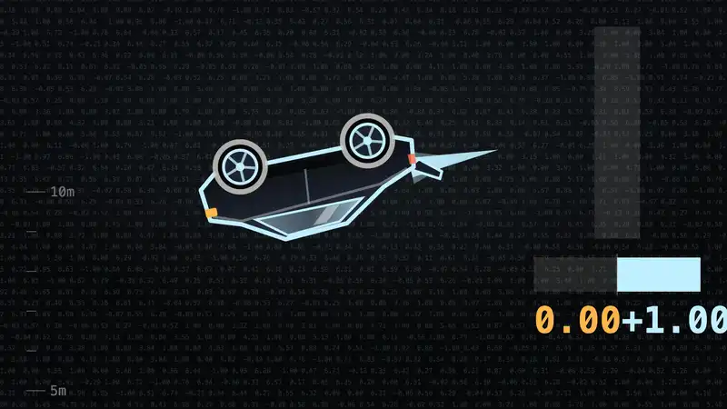</a> 
<b>PPO, made visual</b> · Reinforcement learning 
행동을 직접 고르는 두뇌 PPO — 뒤집힌 로드스터, 이번엔 착지한다 — <a href="https://www.aicitybuilders.com/ppo">page</a> · <a href="https://www.youtube.com/watch?v=NmtM16wqVLs">video</a>
</td>
<td width="50%" valign="top">
<a href="https://www.aicitybuilders.com/localai">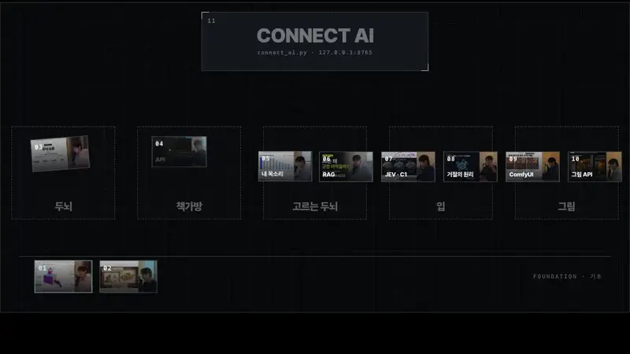</a> 
<b>LOCAL AI</b> · 나만의 인공지능 
빌려 쓰는 AI 말고 소유하는 AI — <a href="https://www.aicitybuilders.com/localai">나만의 인공지능 · 로컬AI의 정석</a> · <a href="https://www.youtube.com/watch?v=uqoOL4kCxXw">video</a> · <a href="https://github.com/wonseokjung/connect-ai">connect-ai</a>
</td>
</tr>
<tr>
<td width="50%" valign="top">
<a href="https://www.youtube.com/watch?v=d-WRGKllOKU">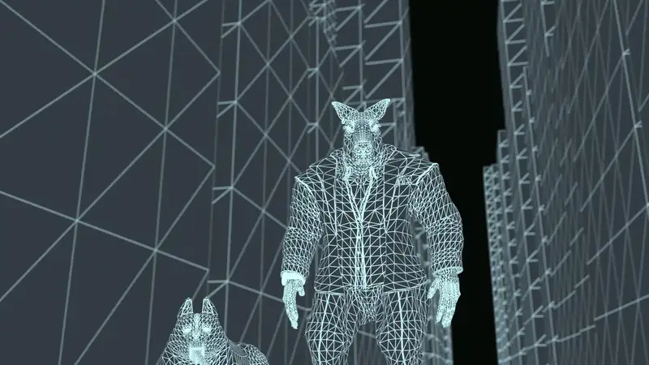</a> 
<b>AI × 3D</b> · Blender MCP 
바이브코딩으로 AI 3D 영상 만들기 — <a href="https://www.youtube.com/watch?v=d-WRGKllOKU">video</a>
</td>
<td width="50%" valign="top">
<a href="https://www.youtube.com/watch?v=pnQUKnmPkFg">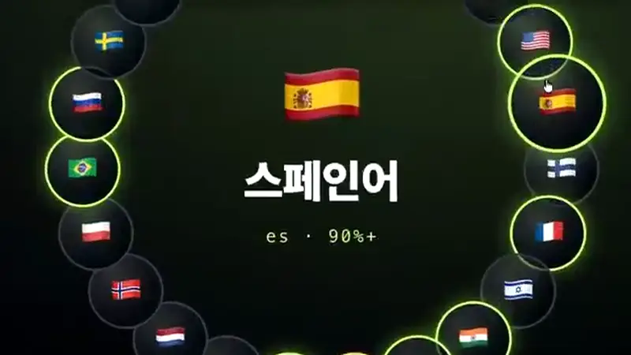</a> 
<b>AI DUBBING</b> · In your own voice 
로컬 AI로 다국어 더빙하는 법 — <a href="https://www.youtube.com/watch?v=pnQUKnmPkFg">video</a>
</td>
</tr>
<tr>
<td width="50%" valign="top">
<a href="https://www.youtube.com/watch?v=4cmQ-YIeb7U">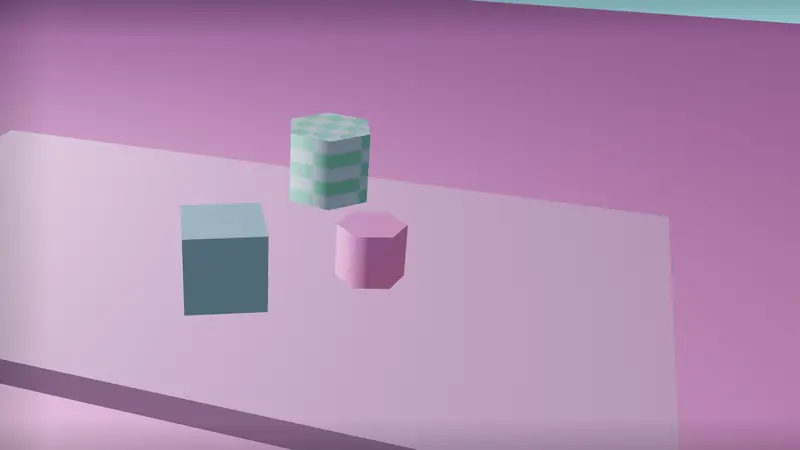</a> 
<b>RESEARCH</b> · ICAART 2027 · 112 co-authors 
112명이 공동 저자로 이름을 올린 AI 논문, ICAART 2027 제출 — <a href="https://www.youtube.com/watch?v=4cmQ-YIeb7U">video</a> · <a href="https://www.youtube.com/watch?v=OpbRQWA58u8">논문 16편을 게임처럼</a>
</td>
<td width="50%" valign="top">
<a href="https://www.youtube.com/watch?v=7NBu5IW_2Xw">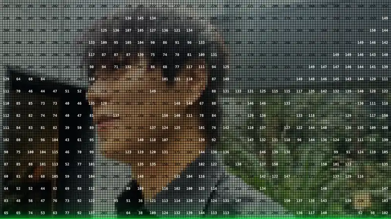</a> 
<b>MOTION × CODE</b> · Remotion, three.js 
바이브코딩으로 영상 만들기, 예제 44개 코드까지 — <a href="https://www.youtube.com/watch?v=7NBu5IW_2Xw">video</a>
</td>
</tr>
<tr>
<td width="50%" valign="top">
<a href="https://www.youtube.com/@CONNECT-AI-LAB">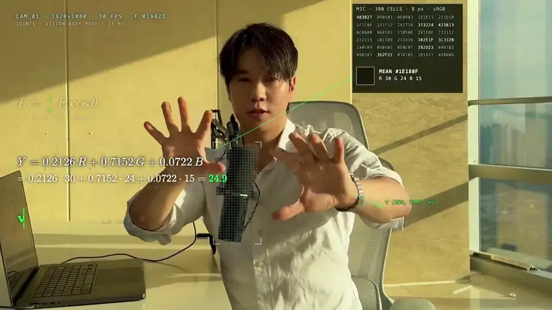</a> 
<b>AR</b> · Live in both worlds 
AR · CONNECT AI LAB — <a href="https://www.youtube.com/@CONNECT-AI-LAB">YouTube</a>
</td>
<td width="50%" valign="top">
<a href="https://www.aicitybuilders.com/robot">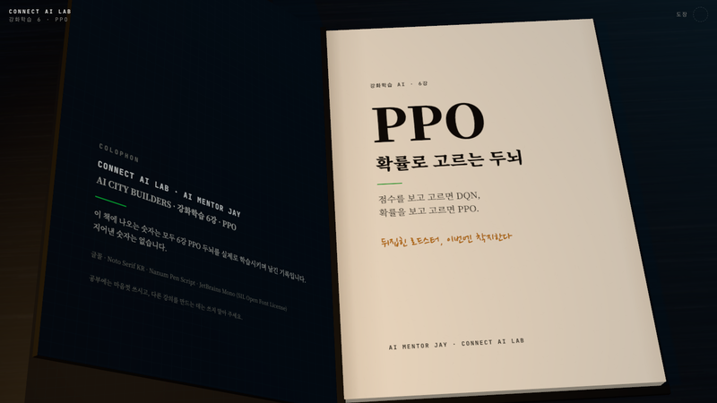</a> 
<b>3D TEXTBOOKS</b> · Students only 
PPO 입체 교과서 · 로컬 AI 11강 교재 — <a href="https://www.aicitybuilders.com/robot">강화학습 AI</a> · <a href="https://www.aicitybuilders.com/localai">나만의 인공지능</a>
</td>
</tr>
</table>

 

<picture>
  <source media="(prefers-color-scheme: dark)" srcset="./assets/svg/sec03_dark.svg" />
  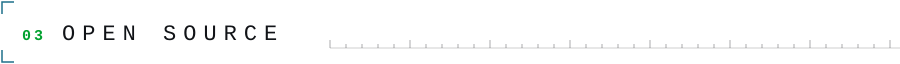
</picture>

| | |
|---|---|
| [**connect-ai**](https://github.com/wonseokjung/connect-ai)  | 100% 로컬 AI 코딩 에이전트 — Antigravity / VS Code / Cursor에서 오프라인으로 파일 생성, 코드 편집, 터미널 실행. Ollama 기반. |
| [**connect-tycoon**](https://github.com/wonseokjung/connect-tycoon) | 시뮬레이터로 기업 의사결정 모델을 학습시키는 오픈소스 강화학습 게임 · JEV · PPO · Human-in-the-loop |
| [**aicb-colab**](https://github.com/wonseokjung/aicb-colab) | AI CITY BUILDERS 실습 코랩 노트북 — 코랩에서 바로 열립니다 |
| [**tamagotchi-ai**](https://github.com/wonseokjung/tamagotchi-ai) | 내 컴퓨터의 AI를 연결하면 깨어나는 교육용 가상 펫 — 로컬 AI·RAG를 놀면서 배웁니다 |
| [**ai-nightschool**](https://github.com/wonseokjung/ai-nightschool) | 인공지능 1인 기업가를 위한 도서관 — 무료로 배울 수 있는 교재와 프롬프트 |
| [**connectailab models**](https://huggingface.co/models?search=connectailab) | 허깅페이스 강화학습 탭을 채운 connectailab 모델 |

 

<picture>
  <source media="(prefers-color-scheme: dark)" srcset="./assets/svg/sec04_dark.svg" />
  
</picture>

**AI 1인 기업가를 양성하고, 투자합니다.** — <a href="https://www.aicitybuilders.com/ceo">AI CITY BUILDERS</a> 
AI education, for everyone. In every language. — <a href="https://www.aicitybuilders.com/en">aicitybuilders.com/en</a>

| Course | |
|---|---|
| [**AI 콘텐츠 자동화**](https://www.aicitybuilders.com/content-creation) | 분석부터 발행까지, 내 손으로 |
| [**나만의 인공지능**](https://www.aicitybuilders.com/localai) | 로컬AI의 정석 |
| [**강화학습 AI**](https://www.aicitybuilders.com/robot) | 피지컬 AI와 다음 세대 자동화 AI 에이전트의 기반 |
| [**비주얼 바이브코딩**](https://www.aicitybuilders.com/vibecoding) | 보이는 것을 코드로 |

Free first steps: <a href="https://www.aicitybuilders.com/ask">find your first lesson</a> · <a href="https://www.aicitybuilders.com/guide">free learning guides</a> · Business: <a href="mailto:jay@connexionai.kr">jay@connexionai.kr</a>

 

<b>CONNECT AI LAB</b> &nbsp;·&nbsp; AI MENTOR JAY &nbsp;·&nbsp; LIVE IN BOTH WORLDS &nbsp;·&nbsp; Love Reinforcement Learning

